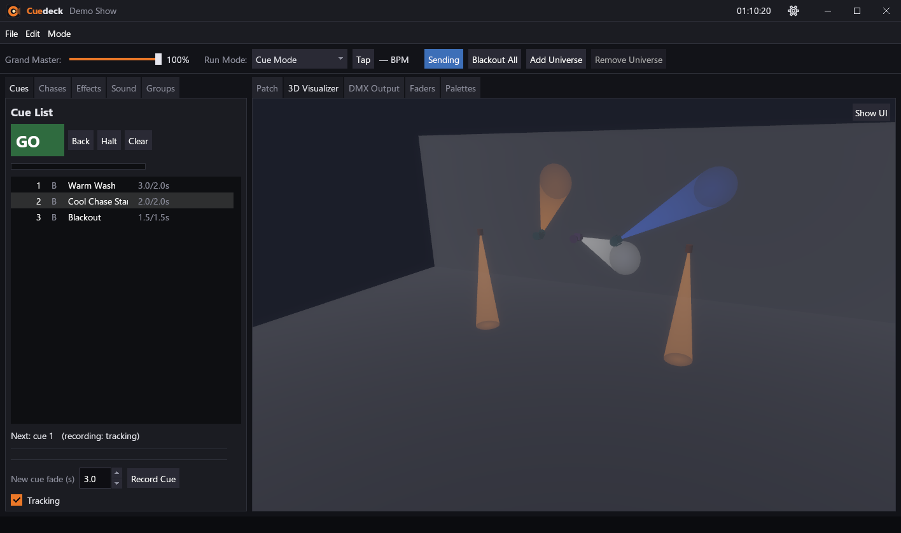

# Cuedeck



Cuedeck is a DMX lighting controller for Windows: a console of cues, chases, effects, sound reactions, groups,
palettes and faders over a patch of real fixtures, a live 3D visualizer of the rig, and light shows built for each
song in your music library and played live as VirtualDJ or Cuepoint plays them. Each universe goes out over
**Art-Net**, **sACN (E1.31)** or a **USB DMX interface** (Enttec Open DMX and DMX USB Pro, or the anyma uDMX).

It's the [sLight](https://github.com/KonajuGames/slight-dmx-controller) lighting controller, a Godot 4 project,
ported to C# on .NET 10, drawing its own interface with Vulkan through the framework the Cuepoint DJ app is built on.
Its show files are sLight's, and its DMX output matches sLight's frame for frame. How the port was done is in
[docs/PORT_PLAN.md](docs/PORT_PLAN.md), and every sLight feature is ticked off in
[docs/FEATURES.md](docs/FEATURES.md).

New to Cuedeck? The [**User Guide**](docs/USER_GUIDE.md) walks through it step by step, with screenshots. This README
lists what it does.

## What it does

**The console**

- **Universes**: up to eight, each with its own patch and output: Art-Net (IP, port and universe number), sACN
  (multicast or unicast, with a priority) or USB DMX. A Grand Master, Sending on and off, and Blackout All.
- **Patch**: fixtures from built-in profiles, a library of about 640 real fixtures from the
  [Open Fixture Library](https://open-fixture-library.org) (and its current list online, and GDTF-Share with an
  account), GDTF and Open Fixture Library files, or profiles made and edited by hand: several modes, 16-bit channels,
  named slots for gobo and colour wheels, multi-head fixtures. Each fixture gets controls made for it: colour pickers,
  a pan/tilt pad, slot dropdowns and sliders, a virtual dimmer when it has none of its own, Flash and Home.
- **Cues**: GO, Back, Halt and Clear, split fade up and down times, delays, follows, tracking or block cues, Load to Patch,
  Update, and palettes referred to rather than copied.
- **Chases**: captured steps cycled at a tempo, with crossfade and direction, or stepped on the beat.
- **Effects**: sine, triangle, sawtooth, square and random waves on one kind of channel, fanned across fixtures,
  around a fixed centre or each channel's own level, at their own rate or the tempo clock's.
- **Sound**: any Windows input's bass, mid, treble and level, a beat detector and spectrogram, and reactors that put
  them on fixtures, in Sound Reactive mode.
- **Groups**, **palettes** (colour, position, beam) and **playback faders** (cue submasters, chases, group masters,
  effects), the faders learnable from a MIDI controller's CCs, pitch bends and notes.
- **Tempo clock**: tap tempo, MIDI clock, or VirtualDJ's beats.
- **MIDI and OSC triggers** for cues, chases, effects, the tempo and flashes, with LED feedback to the controller.
- **Live flashes**: Blackout, Strobe, White and Colour, held or latched, from the screen, the keyboard or a pad.

**The 3D Visualizer**

- The patched rig lit live by the console's output: colour, intensity, pan and tilt, zoom, strobe, gobos projected
  and spinning. GDTF fixtures drawn from their own models; the rest by kind.
- Haze, shadows, bloom on bright beams and lenses, a work light, three rooms, saved camera views, trusses and glTF set pieces, fixtures placed by
  dragging or by numbers, with undo.
- Three looks, chosen in the options: Dark, Light for daylight, and High contrast for bright rooms, shared with
  Cuepoint. The 3D visualizer, the timeline, waveforms and meters stay dark in every look.
- A screen size in the options, from 100% to 200% (as Windows has it for the screen to begin with), for a 4K screen
  or one seen from further away, shared with Cuepoint: everything's drawn bigger, its text and the 3D view sharp at
  that size. It changes the next time Cuedeck starts; `--scale 1.5` tries one for a single run.
- Every keyboard shortcut over the screen with **?**, or from **Help > Keyboard Shortcuts**.
- Screenshots (PNG) and recordings (MP4, with whatever the computer's playing as the sound), a window of its own for a
  second screen, and MVR import and export.

**DJ Edit Mode and DJ Perform Mode**

- A music browser over this computer's folders and VirtualDJ's or Cuepoint's virtual folders, with their libraries'
  tags, tempos, keys and beat grids.
- Each song's structure analysed (beats, bars, sections, key) and editable; a light show generated from it; and a
  timeline per fixture and head to edit it by hand: dimmer lines, colours, strobes, named positions and movements, with
  selection, copy and paste, undo, mute, solo and collapse.
- Named positions for moving heads, aimed on a pad with the fixtures lit live.
- DJ Perform Mode follows VirtualDJ (or Cuepoint) over OS2L, advertised on the network, and plays the light shows of
  the songs on its decks, mixed as the DJ mixes. A song without a show gets one generated as it plays.

**The show**

- One `.slight` file, with the songs' timelines in a folder beside it, readable by sLight and sLight's readable by
  Cuedeck. The last show opens again at start, an autosave runs every minute with a restore after a crash, and each
  file dialog remembers its folder.

## Running it

You need Windows, the .NET 10 SDK and a GPU with Vulkan 1.3 drivers, and
[cue-framework](https://github.com/KonajuGames/cue-framework) checked out beside this repository (as `..\cue-framework`), for the window,
rendering and UI code Cuedeck shares with Cuepoint.

```bash
dotnet run --project Cuedeck
```

To open a show straight away, pass it on the command line:

```bash
dotnet run --project Cuedeck -- "My show.slight"
```

Debug builds turn on Vulkan's validation layers when the Vulkan SDK is installed. Cuedeck keeps its settings,
autosaves, custom fixture profiles, renders and error log in `%LOCALAPPDATA%\Cuedeck`.

Coming from sLight, open your shows as they are. sLight's own files (its custom fixture profiles and their models,
settings, remembered folders, preset and last show, in `%APPDATA%\Godotpp_userdata\sLight`) are offered for import
at Cuedeck's first start, and under **Options → Import from sLight** any time; nothing of either app's is overwritten.

1. On the **Patch** tab's **Universe 1** page, pick an **Output**, set its target (for Art-Net, the IP, port and
   universe; `127.0.0.1:6454` universe 0 by default) and click **Apply Connection**.
2. Patch some fixtures and move their controls: the universe is sent 30 times a second while **Sending** is on, as
   DMX equipment expects a continuous stream.
3. Set a look, **Record Cue**, repeat, and step through the cues with **GO** (or the spacebar).

### Testing without real hardware

You don't need lights to try it. [QLC+](https://www.qlcplus.org) (free and open source) can receive Art-Net and sACN
and show the DMX values live, and any Art-Net monitor will do the same. The 3D Visualizer shows the rig as the
console's driving it, with Sending on or off.

### Going to real fixtures

Point a universe at an Art-Net or sACN node (an Enttec ODE, a DMXking node, an ESP32 node, a console's network input)
on your network, with the matching universe, and the node turns the packets into a DMX512 signal for your fixtures.
Or plug in a USB DMX interface (below).

## Output: Art-Net, sACN or USB DMX

Each universe's **Output** chooses where its frames go.

- **Art-Net** (the default): ArtDMX packets to an IP and port, with an Art-Net universe number. Several universes can
  share a number on different IPs.
- **sACN** (ANSI E1.31): multicast to `239.255.<hi>.<lo>` on UDP 5568, or unicast to an IP you give, with a priority
  from 0 to 200. The source's identity is kept in the show, so receivers see one steady source.
- **USB DMX**: an **Enttec DMX USB Pro** or a look-alike (DMXking ultraDMX and other "pro" interfaces: a framed
  message, with the interface doing the DMX timing), or an **Enttec Open DMX USB** (a bare FTDI chip: Cuedeck makes
  the break itself and streams the frame at 250 kbaud; fine for LED pars, less steady for movers), or an **anyma
  uDMX** (sent its channels a frame at a time, at 20 to 25 frames a second). The FTDI ones go through FTDI's D2XX
  driver (`ftd2xx.dll`) where it's installed. Without it, and for the uDMX, they go through **libusb**
  (`libusb-1.0.dll`, beside Cuedeck or on the path), with a libusb or WinUSB driver bound to the interface (the
  uDMX's own installer, or [Zadig](https://zadig.akeo.ie); swapping an FTDI interface's driver that way stops D2XX
  seeing it). With neither library, the USB output isn't offered. **Auto** guesses the interface's kind from its name.
  An interface that can't be opened leaves its universe on Art-Net.

## Screenshots

The user guide's screenshots and the one above are taken by Cuedeck itself:

```bash
dotnet run --project Cuedeck -- --capture docs/img
```

It patches and programs a demo rig, sets up each scene and saves the window's picture as a PNG, then closes. Name
shots after the folder to take only those (`01-patch-tab`, `screenshot`, …). It runs on a scratch app folder, with
made-up songs in place of your music, so your settings, shows and library are neither read nor changed. Move
`screenshot.png` up to `docs/` after a full run.

A video tour of the main features is made the same way. Cuedeck plays through them by itself, recording every frame
it draws (it needs [ffmpeg](https://ffmpeg.org/) built with libx264 and libass), and then
[docs/tour/annotate.py](docs/tour/annotate.py) (Python 3.8+ with Pillow) adds the captions, highlights, keys and mouse,
and the songs where they played, as `cuedeck-tour.mp4`. Nothing is heard while it records, and the window lets the
mouse through, so the computer can be used meanwhile:

```bash
dotnet run --project Cuedeck -c Release -- --tour tour --ffmpeg path/to/ffmpeg.exe
python docs/tour/annotate.py tour --ffmpeg path/to/ffmpeg.exe
```

## Tests

```bash
dotnet test
```

The tests run without a window, a GPU, a sound card or a network. Many were ported from sLight's own; the
`Golden/` tests check Cuedeck's DMX output and generated light shows against sLight's, recorded by
`tools/slight_frames.gd` and `tools/slight_generator.gd`.

## Layout

- `Cuedeck/`: the app. `Rendering/`, `Input/` and much of `UI/` come from Cuepoint (see [FRAMEWORK.md](FRAMEWORK.md));
  `Fixtures/`, `Dmx/`, `Show/`, `Audio/`, `Timelines/`, `Perform/` and `Visualizer/` are ported from sLight.
- `Cuedeck.Tests/`: xUnit tests.
- `tools/`: Godot scripts that record sLight's output for the golden tests.
- `docs/`: the [user guide](docs/USER_GUIDE.md), the [feature checklist](docs/FEATURES.md) and the
  [port plan](docs/PORT_PLAN.md).

## License

MIT; see [LICENSE](LICENSE). The bundled fixture library is the Open Fixture Library's (see
[its attribution](Cuedeck/Fixtures/Library/ATTRIBUTION.md)).
