# Cuedeck User Guide

A step-by-step walkthrough for a new user, from opening the app for the first time to running a show. For a list of
every feature, see the [README](../README.md); this guide covers the everyday workflow, in order, with screenshots.

## What you need

Cuedeck controls real or simulated DMX lighting fixtures from a Windows PC. You don't need any hardware to follow this
guide: see [Testing without real hardware](../README.md#testing-without-real-hardware) in the README for a free way to
watch the DMX output live. When you're ready for real lights, see
[Going to real fixtures](../README.md#going-to-real-fixtures).

Start Cuedeck. There's no setup step, no account and no configuration file to edit first. The window below is what
opens.

## The window, at a glance

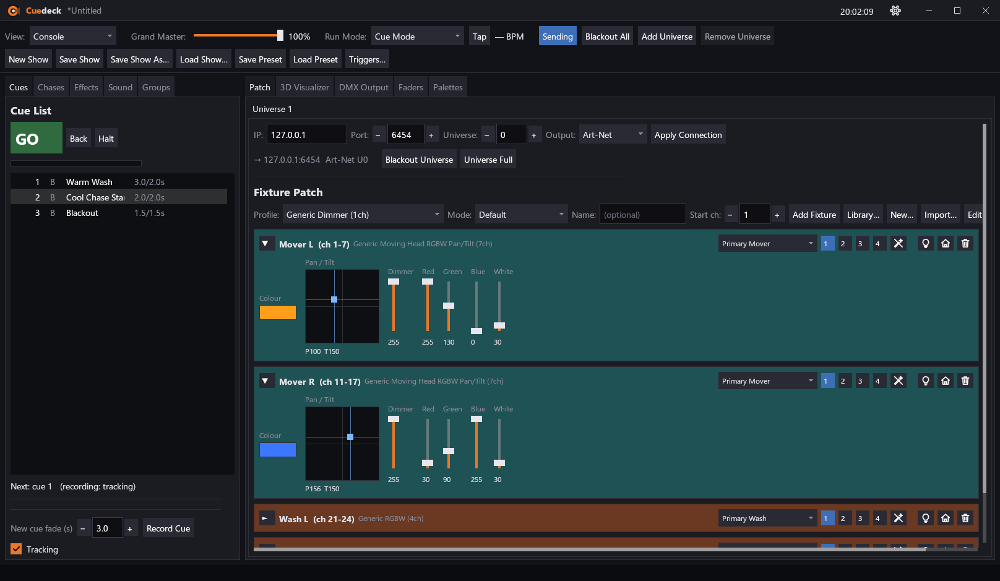

The window has three areas:

- **Top bar**: the **View** selector (**Console**, **DJ Edit Mode**, **DJ Perform Mode**), the Grand Master fader,
  **Run Mode**, the tempo clock's **Tap**, **Sending**, **Blackout All**, Add/Remove Universe, New/Save/Load Show and
  Preset, and **Triggers…** for MIDI and OSC. These stay visible whatever tab or view you're on.
- **Left side, the playback tabs**: **Cues**, **Chases**, **Effects**, **Sound** and **Groups**. This is where you
  build and run a show.
- **Right side**: **Patch** (a page per universe, for patching fixtures and setting them by hand), the
  **3D Visualizer** (your rig lit live by whatever the console's sending), **DMX Output** (every channel's level),
  **Faders** and **Palettes**.

That split is the **Console** view. The **View** selector swaps it for **DJ Edit Mode**, where you build a light show
for each song in your music library, or **DJ Perform Mode**, where your DJ software (VirtualDJ or Cuepoint) plays
those shows live (Steps 10 and 11). The console keeps running underneath either.

The cog at the top right opens **Options**, which set up this computer rather than the show. Its **DJ software**
choice, VirtualDJ or Cuepoint, says whose music library Cuedeck reads: the beat grids, tempos and keys of your songs,
and the virtual folders listed in DJ Edit Mode. VirtualDJ's come from its `database.xml` files and `MyLists`
folders; Cuepoint's from its `library.json` files and the `.m3u8` playlists in `Cuepoint\VirtualFolders` (in
`%LOCALAPPDATA%` and at the root of each drive). Both talk to Cuedeck over OS2L in the same way. A change takes
effect at once and is remembered.

**Coming from sLight?** Open your shows as they are (Load Show): they're the same files. The first time Cuedeck
starts on a computer with sLight's files, it offers to bring them in, and Options has **Import from sLight** for later.
That copies sLight's custom fixture profiles and their models, its settings, the folders its file dialogs remembered,
its preset, and the show it kept if you never gave it a name, and then reopens the show sLight had open last. Nothing
Cuedeck already has is replaced, and sLight's own files aren't changed.

## Step 1: Add a universe and connect it

Each universe is one 512-channel DMX universe, with a page of its own on the **Patch** tab. A new show starts with
**Universe 1**. Pick an **Output**:

- **Art-Net** is the default. Set the target's **IP**, **Port** and **Universe** number; `127.0.0.1:6454` universe
  `0` talks to a monitor running on the same computer.
- **sACN** (E1.31) multicasts by default; give it an IP to unicast instead, and a priority.
- **USB** sends straight to an Enttec Open DMX or DMX USB Pro (or a look-alike), or an anyma uDMX, plugged into
  this computer. It's offered when FTDI's D2XX driver or libusb is installed (the uDMX needs libusb, and a libusb or
  WinUSB driver for the interface); pick the **Device** and its **Interface** type (or leave it on **Auto**), and
  press **Rescan** after plugging one in. A uDMX listed as "uDMX?" was found but has no such driver yet.

Then click **Apply Connection**. The line under the settings says where the universe is going. Add more universes with
**Add Universe** in the top bar (or **Ctrl+Shift+N**) if your rig needs more than 512 channels; **Remove Universe**
(**Ctrl+Shift+R**) asks first, telling you how many fixtures go with it.

## Step 2: Patch your first fixture

Patching tells Cuedeck what kind of light is plugged in where. In the **Fixture Patch** row, pick a **Profile** (a
description of the fixture's DMX channels) and, if it has more than one, a **Mode**. Set the **Start ch** to where it
sits in the universe, give it a **Name** if you like, and click **Add Fixture**. It's added to the list below; click
the arrow at its left to open its controls: a colour picker, a pan/tilt pad for moving heads, and sliders for
everything else (see the screenshot above).

A few generic profiles (Dimmer, RGB, RGBW, moving heads) are built in, but real fixtures vary a lot. Click
**Library…** to search about 640 real fixtures from the [Open Fixture Library](https://open-fixture-library.org):

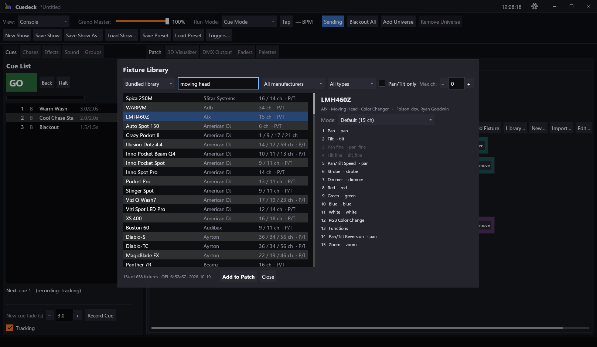

Search by manufacturer or model, filter by type, channel count or pan/tilt, look over a fixture's modes and channels,
then **Add to Patch**. The source dropdown also reaches the Open Fixture Library's current list online, and
GDTF-Share with a free account (its login is used for that session only and never saved). If you have a GDTF or Open
Fixture Library file for something that isn't listed, **Import…** reads it.

**Edit…** opens the selected profile for changes: renaming a gobo wheel's slots, say, or fixing the value ranges it
was imported with. **Save Changes** applies the edit to fixtures you've already patched with that profile too: their
controls are rebuilt with the new ranges and names, and their levels stay as they were. A patched fixture whose mode
now has a different number of channels can't be updated in place, as it might overlap the next fixture's addresses.
It takes the new beam and pan/tilt settings, and you re-patch it for the channel change. The status line says how
many fixtures were updated and how many need a re-patch.

## Step 3: Control a fixture by hand

Every patched fixture gets controls made for it (open one with the arrow at its left):

- A full Red/Green/Blue trio becomes one **colour picker**, one per head on a multi-head fixture.
- A **Pan** and **Tilt** pair becomes a pad: drag the point to aim the head. The mouse wheel nudges it a step for
  fine aiming (tilt, or pan with **Shift**).
- Everything else gets its own slider, kept within its usable range. A wheel with named slots (gobos, colours) gets
  a dropdown of its slots as well.
- A fixture with colour channels but no dimmer of its own gets a **virtual dimmer**, which fades its colour without
  changing it.

On the right of each fixture's row, **Flash** (the bulb; hold it) takes the fixture to full white and puts it back
exactly as it was when you let go, which is handy for finding a fixture in a dark room. **Home** (the house) resets
every control to its default, and **Remove** (the bin) takes the fixture out of the patch. The controls send their DMX
straight away (30 times a second, while **Sending** is on); there's no separate "apply" step.

## Step 4: Record your first cues

When you've set a look you like, go to the **Cues** tab and click **Record Cue**. It captures what every universe is
sending as a new cue. Repeat for a few different looks, then step through them with **GO** (or the spacebar): the
whole rig crossfades to the next cue's look over its fade time. **Back** goes to the cue before, **Halt** stops a fade
where it is, and **Clear** fades the live cue out over its fade down time and leaves no cue live, so the next GO starts
again from cue 1.

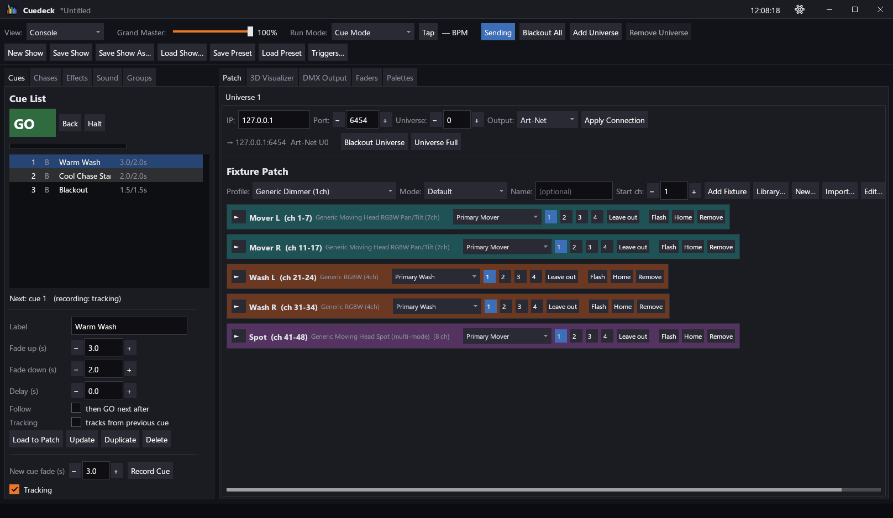

Select a cue to edit its **Label** and **Fade up / down** times. **Delay** holds its fade back for a few seconds after
GO, and ticking **Follow** makes it GO the next cue by itself once its fade is done (after the wait you set beside it):
chain a few to run a sequence from a single GO. The bar under GO shows what's happening: the delay counting down, the
fade's progress and the follow's wait. **Load to Patch** puts a cue's look back on the fixture controls, so you can
change it and press **Update** to record it again.

With **Tracking** ticked (beside Record Cue), a new cue keeps only what it changes from the cues before it, and
everything else carries on through; editing an earlier cue then ripples down the list. Untick a cue's own
**Tracking** to make it a block, which holds a full look and stops the ripple there. The list marks each cue `T` or
`B`.

To build cues from looks you use again and again, use **palettes** (the **Palettes** tab, on the right). Set the
fixtures to a colour, a position or a beam look and click **Record Colour** (or Position, or Beam). Click the palette
later to put the fixtures back there.

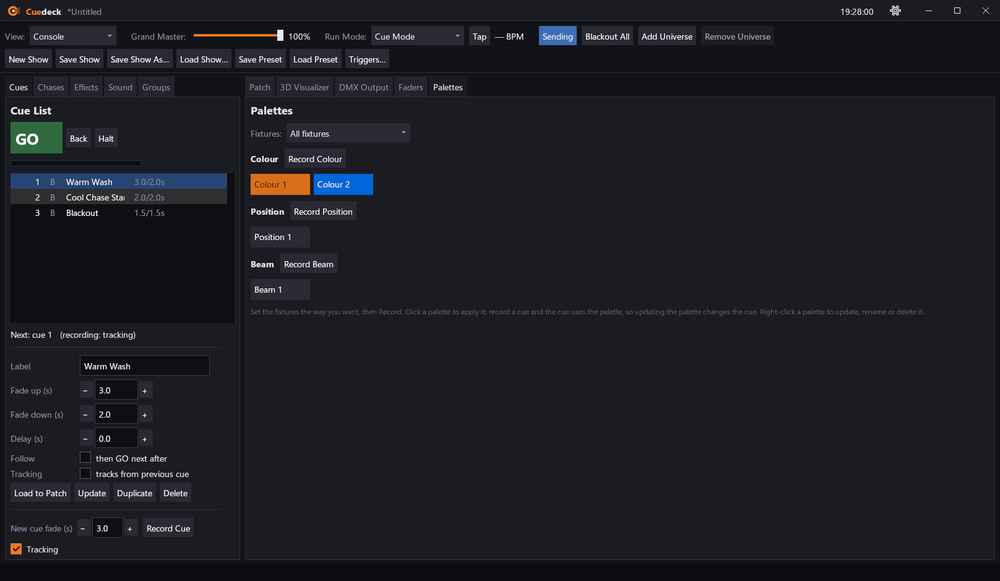

A cue recorded with a palette applied remembers the palette rather than the levels (it's marked ◆ in the cue list),
so right-clicking the palette and choosing **Update from Live** changes every cue that uses it at once. **Fixtures**
at the top picks whether the tab works on every fixture or a group's.

## Step 5: Add movement with a chase

A **chase** is a list of captured steps that cycle by themselves at a tempo: good for a repeating colour or position
pattern that would be tedious to step through by hand. On the **Chases** tab, click **New Chase**, set a look, click
**Record Step**, and repeat for each step of the pattern.

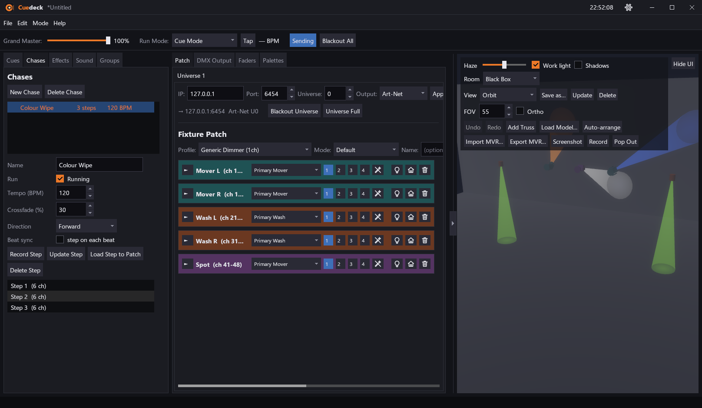

Set the **Tempo (BPM)**, how much each step **Crossfade**s in from the last, and a **Direction** (forward, backward or
bounce). Click **Run** to start it. A chase runs as a layer over whatever your cues are doing, so it doesn't disturb
your programmed look, and it stops cleanly when you turn it off.

## Step 6: Layer in an effect

An **effect** is a smooth waveform (sine, triangle, sawtooth, square or random) applied to one kind of channel: a
breathing dimmer, a pan sweep, a slow colour swell. There are no steps to record.

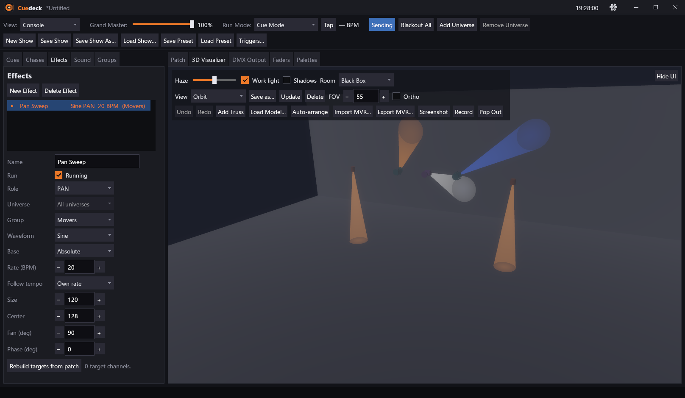

Pick the **Role** it drives, which fixtures (a **Universe**, or a **Group**; see Step 8), a **Waveform**, the
**Rate (BPM)** and the **Size** of its swing. **Fan (deg)** spreads its phase across the fixtures, so instead of every
fixture moving in step you get a ripple across the rig. Try two pan and tilt sine effects 90° apart for a circle. A
**Pickup** base swings around each channel's own level rather than a fixed centre, adding movement to the look on
stage. Click **Run** to start it; like chases, effects layer over your cues without disturbing them.

## Step 7: React to music live

The top bar's **Run Mode** has two settings: **Cue Mode** (the default: the cue list drives playback) and **Sound
Reactive**. Set it to **Sound Reactive** and go to the **Sound** tab to drive the lights from a microphone or line
input.

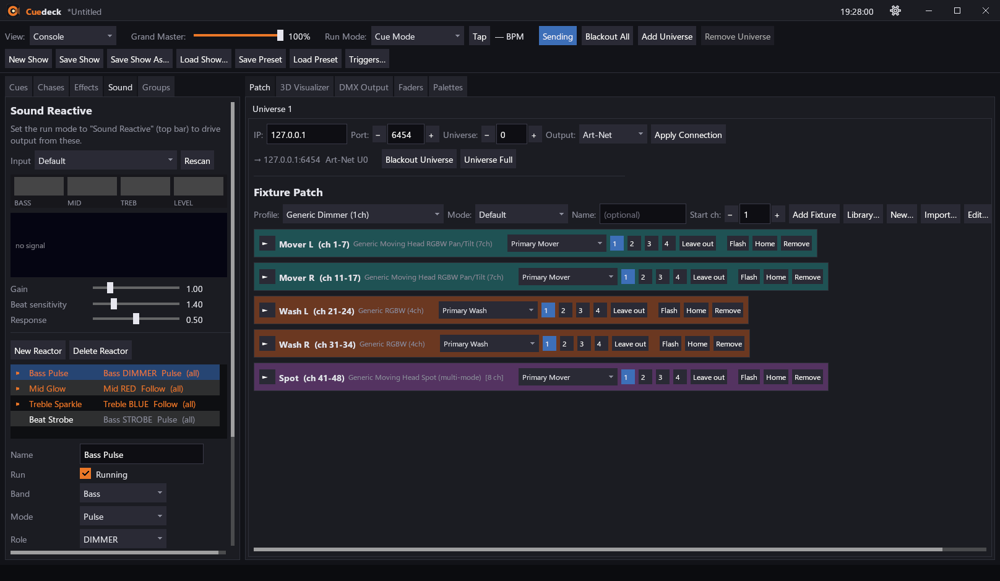

Pick an **Input**, and a live **bass / mid / treble / level** meter and a spectrogram show what's coming in. A
**reactor** maps one band (or the beat) onto a kind of channel: **Follow** tracks the band continuously (bass into a
dimmer swell), and **Pulse** snaps to its high level on every beat and falls back (a beat-synced flash). Four starter
reactors are already there to try: **Bass Pulse**, **Mid Glow**, **Treble Sparkle** and **Beat Strobe** (off to begin
with, as it's much more intense than the others). Edit or delete them, or add your own with **New Reactor**, and tick
**Run** on the ones you want.

To lock chases to the music's tempo rather than to what the microphone hears, click the top bar's **Tap** (or press
**T**) on the beat: a few taps set the tempo clock, shown beside it as `128.0 BPM · Tap`. Chases with **step on each
beat** ticked then step on its beats in either run mode, and an effect's **Follow tempo** runs it once every so many
beats. A MIDI clock from DJ software or a drum machine sets the clock by itself, and so do VirtualDJ's beats in DJ
Perform Mode. The **✕** beside the read-out stops it.

## Step 8: Organise fixtures into groups

The **Groups** tab holds named sets of patched fixtures, so an effect or reactor can work on just the movers, or the
front truss, instead of a whole universe.

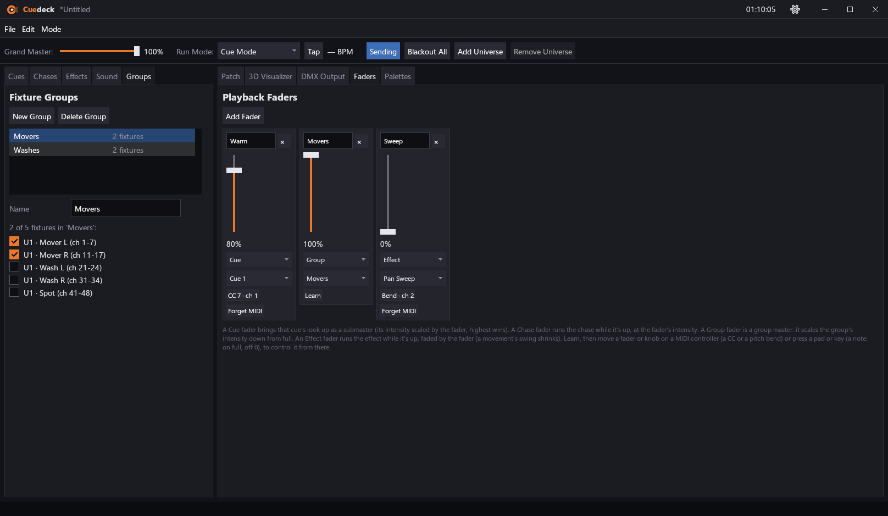

Click **New Group**, then tick the fixtures that belong in it. The checklist follows the patch as you add and remove
fixtures. Pick the group's name in an effect's or reactor's **Group** box instead of a universe.

Groups, cues, chases and effects can also go on **faders**: on the **Faders** tab (on the right), click **Add Fader**
and pick **Cue**, **Chase**, **Group** or **Effect**, and which one.

- A **cue** fader brings that cue's look up as you raise it, mixed with whatever else is on stage.
- A **chase** fader runs the chase at the fader's brightness.
- A **group** fader dims that group, whatever is lighting it.
- An **effect** fader runs the effect while it's up. A dimmer or colour effect fades with the fader; a movement
  effect's swing shrinks toward its centre. Pull a chase or effect fader to 0 and it stops, and belongs to the Chases
  or Effects tab again.

To drive a fader from a MIDI controller, click **Learn**, then move a fader or knob or press a pad. The button then
shows what it learned:

- a **CC** (most faders and knobs), such as "CC 7 · ch 1";
- a **pitch bend** (some controllers' faders send these), such as "Bend · ch 2": fully down is 0%, fully up 100%;
- a **note** (a pad or key), such as "Note 36 · ch 1": pressing it takes the fader to 100% and letting go to 0%, so it
  works as a hold button.

A controller's fader that stops just short of its end still reaches 0% or 100%: the last 2% of travel at each end
counts as the end. **Forget MIDI** (or right-clicking the mapping button) forgets it.

## Step 9: See it in 3D

The **3D Visualizer** tab (on the right) shows your rig lit live by whatever the console is sending: cues, chases,
effects and the grand master all show, all the time.

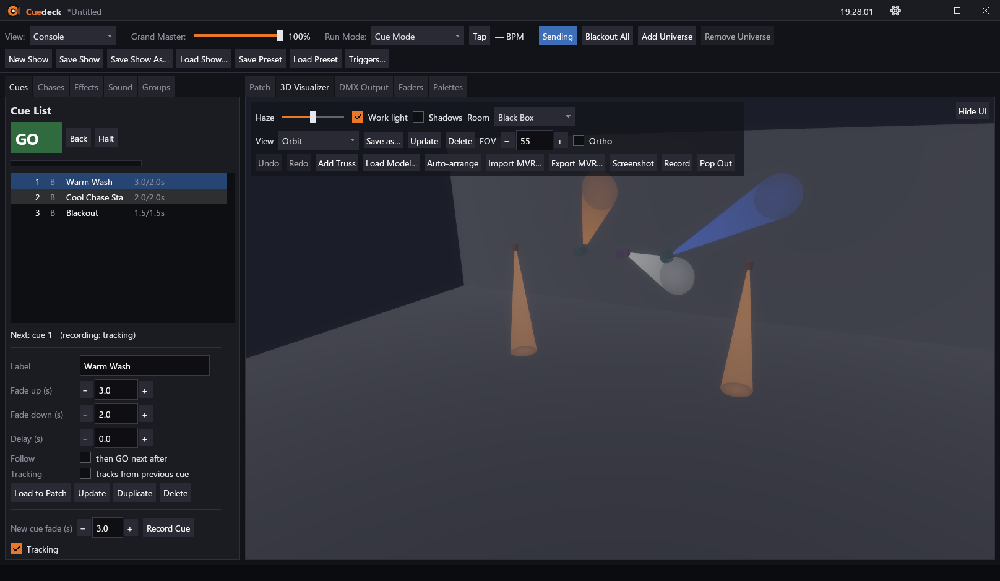

Drag empty space to orbit the camera, middle-drag (or **Shift**+drag) to pan, and use the wheel to zoom. The **View**
dropdown holds saved camera views: five presets and your own (**Save as…**, **Update**, **Delete**), with **FOV** and
**Ortho** beside them. **Auto-arrange** hangs every patched fixture in a tidy grid to start from; click a fixture and
drag it across the floor, or type its exact place and angles, to put it where it really is. **Undo** and **Redo** (or
**Ctrl+Z** and **Ctrl+Y** with the pointer over the view) step through your moves. **Add Truss** and **Load Model…**
(a `.glb` or `.gltf` set piece) dress the stage.

**Haze** puts the beams in the air, **Shadows** lets the brightest lights cast shadows, **Work light** is a dim fill so
you can see the rig with the lights down, and **Room** switches between a black box, a club and an arena. A fixture
imported from a GDTF file with models is drawn as the real fixture, and its gobos are projected. Bright beams and
lenses glow (bloom), as they do on camera.

**Screenshot** saves a PNG of the view and **Record** an MP4 of it, with whatever the computer's playing as its sound
(DJ Edit Mode's song, or your DJ software's). Both go to the `render` folder in Cuedeck's app folder
(`%LOCALAPPDATA%\Cuedeck`), which opens when they're done. **Pop Out** moves the visualizer into a window of its own,
for a second screen at front of house; close that window, or press **Dock to Main**, to put it back. **Import MVR…**
and **Export MVR…** bring a rig in from, or send it to, other lighting software (Vectorworks, Capture, consoles).
**Hide UI** clears the controls away for an unobstructed view.

## Step 10: Build a light show for a song (DJ Edit Mode)

Switch the **View** to **DJ Edit Mode** to program lighting for individual songs rather than cue by cue.

**Find a song.** On the left is a tree of this computer's drives and folders, followed by **VirtualDJ Lists** (your
VirtualDJ virtual folders) or, with Cuepoint chosen in Options, **Cuepoint Lists**. Select one and its music is listed
on the right (title, artist, BPM, key, length, album, genre), with details from your DJ software's library where it
knows the song. Click a column's title to sort by it. Songs that already have a light show in the current show are
marked with a small blue line icon before the title. An orange icon means the show is a temporary one, made in DJ
Perform Mode (see Step 11); edit it in DJ Edit Mode and it becomes your own (blue). MP3, M4A/AAC, WAV, FLAC and Ogg
songs all open.

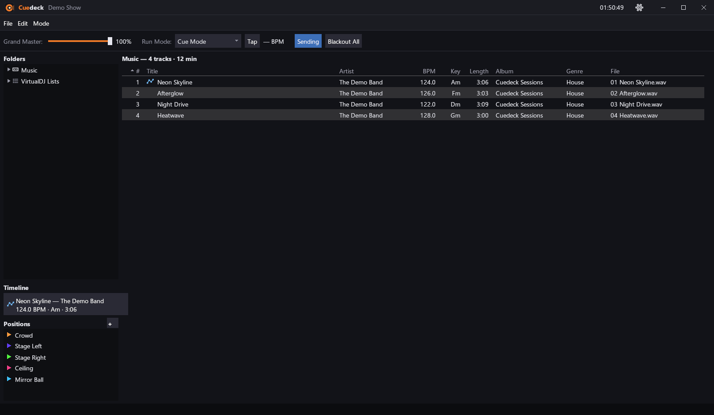

**Regenerate a batch of songs.** Select songs with Ctrl-click or Shift-click, right-click one of them and choose
**Regenerate Lighting Timelines**. Each song gets a new light show, just as if you'd opened it and clicked
**Generate**. Each song's row fills like a progress bar as it goes, and each show is saved as soon as it's done. Open
the song and **Ctrl+Z** takes it back to what it had. A song that can't be analysed is left as it was; hover over its
title to see why. Save the show first, as the timelines are kept with it.

**Open its timeline.** Double-click a song. The list is replaced by its timeline, with the song's title, artist, BPM,
key and length in the heading above it (select a folder to go back). The **Timeline** section on the left shows the
song that's open: click it to get back to its timeline from the list or a position. The timeline opens showing the
whole song:

- Along the bottom is a colour waveform of the song, with its beat grid drawn behind it and the bars numbered along
  the top. The mouse wheel zooms, **Shift**+wheel scrolls, and dragging with the middle button pans. The slim overview
  beneath shows the whole song: drag its rectangle, or click to jump.
- **Play / Pause** (or **Space**) and **Back to start** sit to the right. The red playhead runs down every timeline;
  click or drag it on the waveform, the bar ruler or any timeline to move it.
- Above the waveform is the song's **structure** (Intro, Verse, Chorus and so on), worked out in the background when
  the song opens. It's locked to begin with: click the padlock to fix a section border the analysis put slightly wrong
  (drag it; all the way to the next border deletes the section between), or right-click a section to relabel, split
  or delete it. Right-click > **Snapping** chooses whether borders and selections snap to bars, beats or nothing.
- Above the structure is the **master** timeline, which drives every fixture, and above that a scrolling timeline for
  each patched fixture (and each head of a multi-head fixture).

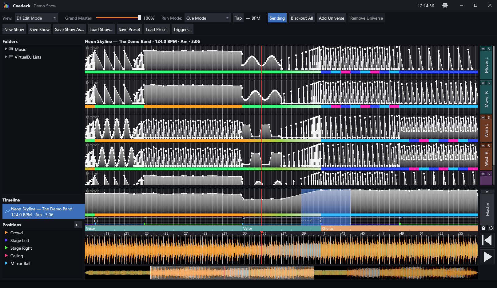

While the song plays, the lights and the 3D Visualizer follow the playhead exactly as they will in a live show, edits
included. While it's paused, the look at the playhead holds, so you can scrub through and see each moment.

**Let Cuedeck start it for you.** Click **Generate** (beside the padlock) to build a complete show from the song's
structure and energy. The master's dimmer follows the music section by section, rising and falling with its loudness
bar by bar, and every 8 bars the look changes: the fixtures breathe, take turns, hit on the bar or chase across the
rig on the beat as the energy rises. Each kind of section has its own colours. Before a big rise in energy the lights
build to it, with a strobe; breakdowns go dark and cool. Moving heads move between your named positions, the ones
that spread the beams widest for the loudest parts, with movement that grows with the energy. Not keen on the result?
Click **Generate** again for another variation. Each press replaces what the timelines had, as one undo step.

**Generate just part of it.** With areas selected on the timelines (see *Select, then edit* below), **Generate** only
fills those areas and leaves the rest of the song as it was. **Shift**-click **Generate** to analyse the song's
structure afresh first (dropping your changes to it), then generate from that.

**Generate casts each fixture by its category**, chosen on the fixture's row in the Patch tab (Primary Mover, say).
Washes carry most of the colour, movers the movement, and multi-cell fixtures play chases and patterns across their
heads. Primary fixtures drive the show, and secondary ones support them with something calmer. The **1–4** buttons
split a category into groups that often step together, so a chase can run group by group (left and right, front and
back). **Leave out** (the wand struck through) keeps a fixture out of the generated show: Generate clears its timelines instead of filling them,
and it ignores the master timeline, though anything you draw on its own timelines still plays.

**Each timeline has rows** for what its fixture can do:

- **Dimmer**: a line of nodes. Drag a node to move it (hold **Shift** to keep to one direction), drag the line to
  raise or lower a stretch, **Ctrl**+click the line to add a node and **Ctrl**+right-click a node to remove it. The
  master's line starts at 0%, so nothing lights until you raise it. A fixture's dimmer row starts empty and follows
  the master; give it values and it overrides the master over that stretch.
- **Colour**: stretches of one colour, or a gradient between two. A fixture with a colour wheel turns it to the
  nearest slot.
- **Strobe**: stretches where the strobe runs Slow, Medium or Fast.
- **Position** (moving heads): which named position the heads point at (see *Named positions* below).
- **Movement** (moving heads): a Circle, Figure 8, Pan Sweep or Tilt Sweep around that position, Small, Medium or
  Large, every 1, 2 or 4 bars, or None to hold still.

**Select, then edit.** Drag across empty parts of the timelines to select an area, over every row the drag crosses,
snapped to bars or beats. **Ctrl**-drag adds another area, and **Shift**-drag extends the last one. **Right-click** the
selection for a menu of what fits: Dimmer shapes (Black, Half, Full, Fade In / Out, Pulse In / Out, Smooth, Pulse on
Every Beat / Bar), Colour (Static Colour…, Gradient…, Rainbow, presets), Strobe speeds, Position, Movement (with Size
and Cycle), and Clear for each. Drag a selection's start or end to resize it (what sits on that edge moves with it),
or drag its inside to move its content; a ghost shows where it will land.

| Keys | Does |
| --- | --- |
| **Delete** | Clear the selected areas |
| **Ctrl+C / Ctrl+X / Ctrl+V** | Copy / cut / paste: into every selected fixture at once, or at the playhead with nothing selected |
| **Ctrl+Z / Ctrl+Y** | Undo / redo (each song keeps its own history, up to 100 steps) |
| **Ctrl+A** | Select everything |
| **Escape** or **Ctrl+D** | Clear the selection |

**Mute, solo and tidy up.** Each timeline's name plate, on the right, has an **M** (mute) button, and every one but
the master's an **S** (solo).

- **Mute** leaves a timeline out of playback. Muting the master stops everything; muting a fixture mutes its heads
  too.
- **Solo**: while any timeline is soloed, only the soloed ones play.
- Timelines left out are drawn faded, and their channels are left to the console, as if the song didn't cover them.

Click a fixture's name plate (away from M and S) to **collapse** its timeline to a slim bar with its name, and click
the bar to open it again. A collapsed timeline still plays, but can't be edited or selected. It's a quick way to get
the fixtures you aren't working on out of the way.

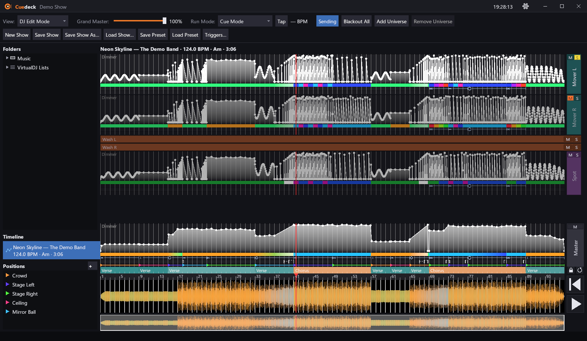

Mute, solo and collapse are saved with each song's timelines and DJ Perform Mode plays the song the same way, but
they aren't undo steps.

A song's timelines are saved by themselves when you leave it (open another song, switch view or close the app) and
with **Save Show**. They're kept with the show (see *Saving your work*), and a song that's been moved or renamed keeps
its light show.

### Named positions

Moving heads point at **named positions** rather than raw pan and tilt values. Below the folders and the timeline on
DJ Edit Mode's left, the **Positions** header lists them; click its **+** to add one. It opens in the **position
editor**: a large pan/tilt pad beside a list of every moving fixture. Select fixtures in the list (**Ctrl** or
**Shift** for several) and their points light up on the pad in the position's colour; drag one to aim them. While
they're selected, those fixtures are lit full white and pointed live at the position, so you can see where they land
in the room, and they go back to how they were when you leave. Rename the position at the top of the editor, and
right-click one in the list to **Rename**, **Duplicate** or **Delete** it.

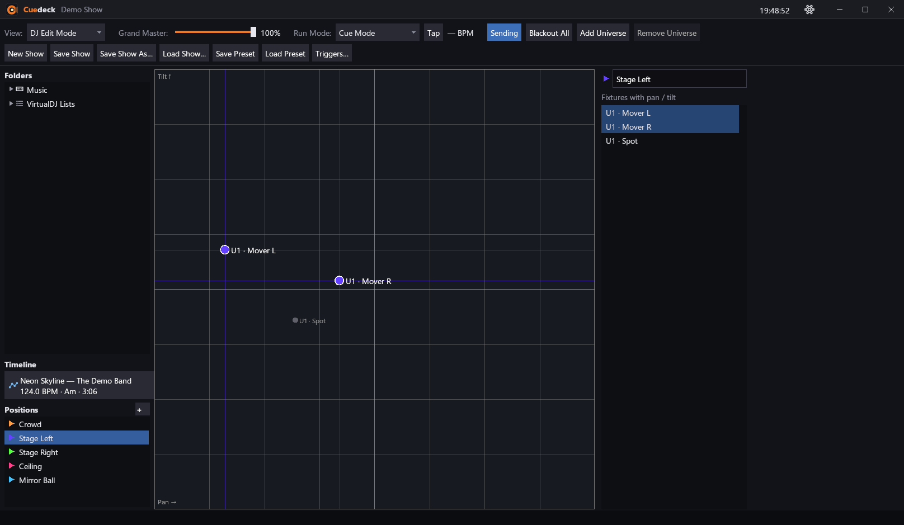

To reuse aim points, select fixtures and press **Ctrl+C**, then select fixtures (in this position or another) and
press **Ctrl+V**: the selected fixtures take the copied points in list order. Right-click the fixture list for
**Snap Together** (every selected fixture aimed at the average of their points), **Spread** (the ones between the
first and last spaced evenly along the line joining them) and **Reset** (back to the centre).

Use positions in a timeline's Position row (right-click > **Position**), or let **Generate** spread them across the
song.

## Step 11: Play it live with VirtualDJ (DJ Perform Mode)

Cuepoint works the same way over OS2L; everything below about VirtualDJ applies to it too, apart from the
`os2lDirectIp` setting and skins.

Switch the **View** to **DJ Perform Mode** and Cuedeck starts listening for VirtualDJ over OS2L. It's advertised on the
network as "Cuedeck" (port 9960), so VirtualDJ normally finds it by itself; otherwise point VirtualDJ's `os2lDirectIp`
setting at this computer. The page shows the connection and, for each of up to four decks, the song loaded, whether
it's playing, its position and its timelines. Only the decks your VirtualDJ skin shows are followed: with a two-deck
skin, decks 3 and 4 read "not in the skin".

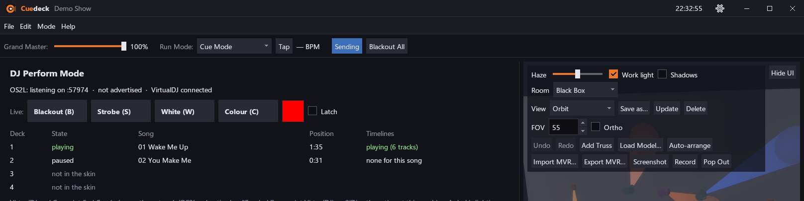

Whenever a deck loads a song, its light show from DJ Edit Mode loads in the background. A deck drives the lights while
it's **playing with its volume fader up** (a song you're cueing in your headphones with the fader down stays dark),
following VirtualDJ's position and pitch. When two decks play together during a mix, their shows blend: the brightest
wins for colour, dimmer and strobe, and pan and tilt are averaged.

**Songs without a light show** get a temporary one. Within moments of the song loading, the deck has a simple show in
time with the beat. Meanwhile the song is analysed in the background, and a few seconds later a full show generated
from its structure takes over, as **Generate** would make it. It's saved with the show, marked temporary (an orange
icon in DJ Edit Mode's list); open it and edit it, and it becomes your own. If the show hasn't been saved yet, the
temporary show still plays but isn't kept.

Only what a song's timelines cover is driven; everything else stays as the console has it, and chases and effects
still layer on top. Leaving DJ Perform Mode stops the listener and the playback.

**Live flashes.** For a drop the light show didn't see coming, the **Live:** buttons at the top of DJ Perform Mode
override everything while you hold them: **Blackout**, **Strobe**, **White** and **Colour** (in the colour of the
swatch beside them). Hold **B**, **S**, **W** or **C** for the same, or bind them to pads on a MIDI controller
(**Triggers…**, a *Flash* action). Hold Strobe with White or Colour for a white or coloured strobe. Tick **Latch** if
you'd rather click a flash on and click it off again.

## Optional: MIDI and OSC control surfaces

**Triggers…** in the top bar opens the binding editor, so a MIDI controller or an OSC app like TouchOSC can fire cues,
toggle chases and effects, tap the tempo, flash, or black out.

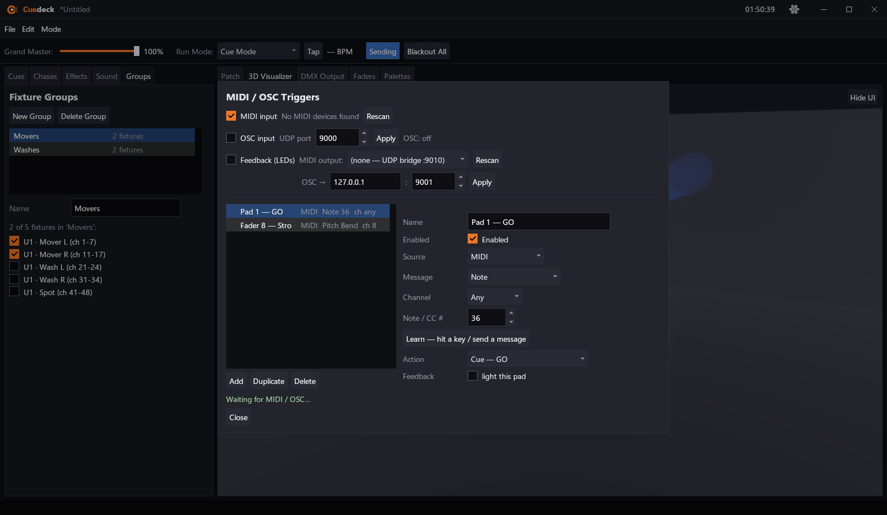

Turn on **MIDI input** or **OSC input**, click **Add**, then **Learn** and play the pad, move the fader or send the
message you want; the match fields fill in from it. Pick an **Action** (Cue GO, a chase or effect toggle, Blackout
All, a flash…). If you plug a controller in after starting Cuedeck, click **Rescan** so it's listened to.

A MIDI binding can be a **Note**, a **Control Change**, a **Program Change** or a **Pitch Bend**. A pitch bend (which
some controllers' faders send) has no number, just its channel: it counts as pressed once it's three-quarters of the
way up and released when it drops back below. To fade something smoothly with one instead, put it on a fader (see
Step 8).

**Feedback (LEDs)** lights a pad to follow what it controls, or as a beat, Sending or run-mode indicator. Pick the
controller's port as the **MIDI output** (or an OSC address for an OSC app). This is all optional: everything else
works with a mouse and keyboard.

## Saving your work

A show lives in one `.slight` file you choose, holding everything: every universe's connection and patch, cues,
chases, effects, groups, palettes, faders, named positions, sound reactors, triggers and the visualizer's stage. The
songs' lighting timelines go in a folder beside it (`MyShow.slight` → `MyShow.timelines`), so keep the two together
when you copy a show to another computer. Show files are the same as sLight's, so either app can open the other's.

| Top bar | Keys | Does |
| --- | --- | --- |
| **Save Show** | **Ctrl+S** | Save to the current show file (asks where, for a new show) |
| **Save Show As…** | **Shift+Ctrl+S** | Save to a new file, copying the timelines folder alongside |
| **Load Show…** | **Ctrl+O** | Open a show |
| **New Show** | **Ctrl+N** | After asking, start an empty show (your output settings are kept) |

The show you last saved or loaded opens again the next time you start Cuedeck, and each file dialog starts in the
folder it was last used in. While you work, Cuedeck also autosaves a copy of the show every minute it has unsaved
changes (your show file is only written when you save). If it ever crashes or the power goes, the next start asks
whether to restore the show as it was at the last autosave; restore it, then **Save Show** to keep it.
**Save Preset** and **Load Preset** are a lighter snapshot of just the DMX levels, for a quick "back to how it looked a
minute ago" without touching your cue list.

## Keyboard shortcuts

| Keys | Does |
| --- | --- |
| **Space** | GO the next cue (Console, Cue Mode) / play or pause the song (DJ Edit Mode) |
| **T** | Tap the tempo |
| **B / S / W / C** (held) | Blackout / Strobe / White / Colour flash (DJ Perform Mode) |
| **Ctrl+N / Ctrl+O** | New show / load a show |
| **Ctrl+S / Shift+Ctrl+S** | Save the show / save it as |
| **Ctrl+Shift+N / Ctrl+Shift+R** | Add a universe / remove the current one |
| **Ctrl+Z / Ctrl+Y** | Undo / redo, in the 3D Visualizer and DJ Edit Mode |

DJ Edit Mode's timeline shortcuts are listed in Step 10.

## Where to go next

This guide covers the everyday path from an empty patch to a running show. The [README](../README.md) lists every
feature, with the finer points: fixture profiles (modes, 16-bit channels, named slots on gobo and colour wheels), sACN
and USB DMX output, cue tracking and blocks, MVR, and how DJ Perform Mode mixes decks.
